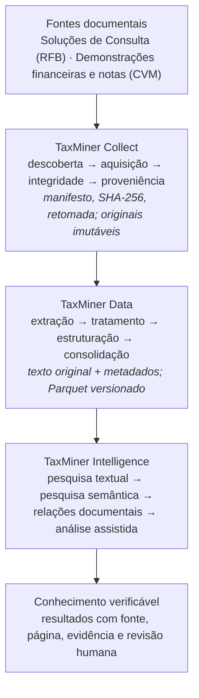

# TaxMiner — Mineração e Inteligência de Documentos Tributários e Financeiros

**Transformando documentos públicos em conhecimento estruturado, pesquisável e verificável.**

[Página do projeto](https://amarallr.github.io/taxminer/) ·
[Painel de fundos (app publicado)](https://amarallr.github.io/taxminer/app/) ·
[Arquitetura](docs/architecture.md) ·
[Requisitos](docs/requirements.md) ·
[Estado atual](docs/project_management/project_status.md) ·
[Licença MIT](LICENSE)

> [!IMPORTANT]
> Projeto independente e de código aberto. **Não é um serviço oficial da Receita Federal do
> Brasil** nem tem vinculação institucional com o órgão ou com a CVM.

<details>
<summary>Sumário</summary>

1. [Apresentação](#1-apresentação-engenharia-de-dados-inteligência-artificial-e-engenharia-de-software)
2. [Visão geral](#2-visão-geral)
3. [Problema que o projeto pretende resolver](#3-problema-que-o-projeto-pretende-resolver)
4. [Objetivos](#4-objetivos)
5. [Fontes documentais](#5-fontes-documentais)
6. [Arquitetura e módulos](#6-arquitetura-e-módulos)
7. [Fluxo de processamento](#7-fluxo-de-processamento)
8. [Funcionalidades previstas](#8-funcionalidades-previstas)
9. [Aplicações práticas](#9-aplicações-práticas)
10. [Inteligência artificial com rastreabilidade e responsabilidade](#10-inteligência-artificial-com-rastreabilidade-e-responsabilidade)
11. [Estado atual do desenvolvimento](#11-estado-atual-do-desenvolvimento)
12. [Tecnologias e ambiente](#12-tecnologias-e-ambiente)
13. [Instalação e configuração](#13-instalação-e-configuração)
14. [Execução e validação](#14-execução-e-validação)
15. [Estrutura de diretórios](#15-estrutura-de-diretórios)
16. [Segurança e privacidade](#16-segurança-e-privacidade)
17. [Documentação complementar](#17-documentação-complementar)
18. [Licença](#18-licença)
19. [Aviso de independência institucional](#19-aviso-de-independência-institucional)

</details>

## 1. Apresentação: engenharia de dados, inteligência artificial e engenharia de software

O **TaxMiner** é um projeto independente e de código aberto (*open source*). Ele coleta,
organiza, processa, integra e analisa documentos públicos de natureza tributária, contábil e
financeira.

O objetivo é transformar grandes volumes de informações dispersas, muitas vezes não
estruturadas ou semiestruturadas, em bases de dados e conhecimento:

- **organizadas e pesquisáveis**, para recuperar o que interessa sem busca manual;
- **rastreáveis**, com vínculo até o documento de origem;
- **acessíveis**, contribuindo para a transparência, a produção de conhecimento e a
  identificação de padrões, relações e possíveis inconsistências.

Órgãos públicos, entidades reguladoras e empresas publicam continuamente informações
relevantes. Esses dados, porém, ficam distribuídos entre plataformas, fontes, formatos e
períodos históricos diferentes, o que dificulta sua integração, recuperação e análise
sistemática.

Para enfrentar esse desafio, o TaxMiner combina **engenharia de dados, processamento
automatizado de documentos, bancos de dados, pesquisa semântica e inteligência artificial
generativa**. Assim, informações fragmentadas viram conhecimento estruturado e útil para
análises financeiras, contábeis, tributárias e regulatórias.

### Inteligência artificial como instrumento de desenvolvimento

Um dos principais diferenciais do TaxMiner está em seu processo de construção: **o projeto é
concebido e desenvolvido integralmente com o apoio de inteligência artificial generativa,
utilizando engenharia de prompts (*Prompt Engineering*) e agentes inteligentes de
desenvolvimento de software**.

Nesse modelo, a IA participa de todas as etapas do ciclo de desenvolvimento:

- levantamento e especificação de requisitos;
- planejamento e definição da arquitetura;
- implementação e revisão de código;
- elaboração de testes e documentação;
- manutenção e evolução contínua.

Como o processo se organiza:

- **Engenharia de prompts:** traduz requisitos funcionais, regras de negócio e decisões
  arquiteturais em instruções estruturadas, contextualizadas, verificáveis e reproduzíveis.
- **Supervisão humana:** continua responsável pela definição dos objetivos, pelas decisões
  técnicas e funcionais, pela avaliação dos resultados e pela aceitação das entregas.
- **Referência de boas práticas:** o **SWEBOK (*Software Engineering Body of Knowledge*), do
  IEEE Computer Society**, abrangendo engenharia de requisitos, arquitetura e projeto de
  software, construção, testes, manutenção, qualidade, gerenciamento de configuração e
  processos de engenharia.
- **Práticas complementares:** modularidade, versionamento com Git, integração contínua (CI),
  testes automatizados, rastreabilidade de requisitos, documentação técnica e validação
  sistemática, buscando qualidade, confiabilidade, segurança, auditabilidade e
  sustentabilidade do software.

### Inteligência artificial como componente da plataforma

Além de apoiar seu desenvolvimento, a inteligência artificial constitui um dos componentes
tecnológicos do próprio TaxMiner.

A plataforma integra engenharia de dados, processamento de documentos, recuperação de
informações e modelos de linguagem de grande porte (*Large Language Models — LLMs*). Eles
apoiam a extração, classificação, estruturação, contextualização e análise de informações de
diferentes fontes documentais.

Essa abordagem permite:

- explorar grandes conjuntos de documentos;
- identificar relações entre entidades e reconhecer padrões;
- comparar informações ao longo do tempo;
- apoiar a identificação de inconsistências e situações que mereçam investigação adicional.

A arquitetura prioriza a preservação das fontes originais, a rastreabilidade das
informações, o uso de dados estruturados sempre que disponíveis e a fundamentação das
análises em evidências documentais verificáveis. Isso reduz o risco de interpretações
incorretas e de informações sem suporte nas fontes consultadas.

### Uma abordagem integrada de inovação

O **TaxMiner reúne duas aplicações complementares da inteligência artificial generativa: como
tecnologia utilizada na construção do software e como capacidade incorporada ao produto
desenvolvido**.

Por isso, o projeto é também uma iniciativa experimental de engenharia de software orientada
por IA. Ele explora como a combinação entre conhecimento especializado, engenharia de prompts,
agentes inteligentes e práticas consolidadas de desenvolvimento pode acelerar a construção de
soluções tecnológicas complexas.

Ao integrar engenharia de dados, IA generativa e boas práticas de engenharia de software, o
TaxMiner busca demonstrar uma abordagem de desenvolvimento aberta, documentada, reproduzível e
tecnicamente rigorosa. Nela, a automação inteligente amplia a capacidade de implementação sem
substituir a responsabilidade humana pela qualidade, segurança e confiabilidade dos
resultados.

## 2. Visão geral

| Aspecto               | Descrição                                                                                                                                                                        |
| --------------------- | -------------------------------------------------------------------------------------------------------------------------------------------------------------------------------- |
| **O que é**           | Um conjunto de pipelines em R e uma interface local de pesquisa (prevista) sobre documentos públicos.                                                                            |
| **Para quem**         | Desenvolvedores, profissionais de dados, pesquisadores, contadores, auditores, tributaristas e analistas financeiros e de riscos.                                                |
| **Escopo**            | Soluções de Consulta da Receita Federal, notas explicativas das demonstrações financeiras entregues à CVM e informes de fundos de investimento da CVM (FII, FIDC, FIP e FIAGRO). |
| **Princípio central** | Toda informação mantém o vínculo com o documento oficial de origem: URL, data de obtenção, hash e página.                                                                        |
| **Estágio**           | Em desenvolvimento. Nenhum MVP foi concluído ou liberado; veja a [seção 11](#11-estado-atual-do-desenvolvimento).                                                                |

## 3. Problema que o projeto pretende resolver

- **Dispersão.** Interpretações tributárias e divulgações contábeis ficam em portais
  diferentes, cada um com sua forma de busca, seus formatos e sua própria cobertura histórica.
- **Formatos difíceis.** Boa parte do conteúdo está em PDF ou em pacotes XML/ZIP, com
  tabelas, cabeçalhos e numeração que dificultam a extração automática.
- **Pesquisa histórica limitada.** Comparar um assunto ao longo de vários anos, empresas ou
  unidades emissoras exige trabalho manual e repetitivo.
- **Cruzamento trabalhoso.** Relacionar o que uma empresa divulga com a interpretação oficial
  da legislação exige localizar e ler os dois lados com as citações corretas.

## 4. Objetivos

1. Adquirir documentos públicos de forma controlada, legal e reprodutível, com registro de
   proveniência e integridade.
2. Estruturar o conteúdo, preservando o texto original e as classificações oficiais, em
   formatos analíticos abertos (Parquet).
3. Oferecer pesquisa textual e, depois, semântica, com citação da fonte e da página em cada
   resultado.
4. Apoiar análises que relacionem as fontes, sempre como hipóteses com evidências e sujeitas a
   revisão humana.
5. Medir qualidade com critérios explícitos (cobertura, reprodutibilidade, relevância e
   citações) antes de declarar qualquer fase concluída.

## 5. Fontes documentais

### 5.1 Soluções de Consulta tributárias (`tax_consultation_decisions`)

**O que são.** A Solução de Consulta é a resposta formal da Receita Federal a uma dúvida de
um contribuinte sobre como aplicar a legislação tributária a uma situação concreta. A emitida
pela Coordenação-Geral de Tributação (Cosit) vincula a administração tributária e orienta
casos semelhantes. Por isso é uma fonte importante para entender a interpretação oficial da
lei.

**Como são publicadas e identificadas.** Cada ato tem tipo (Solução de Consulta, Solução de
Consulta Interna, Solução de Divergência…), unidade emissora, número, ano, data de publicação
e uma ementa que resume o assunto, a conclusão e os dispositivos legais. A publicação é feita
no Diário Oficial e no sistema Normas da Receita Federal.

**Dificuldades.** A busca oficial é feita ato a ato. A verificação de fontes (Collect P01)
mostrou que ementas e metadados são acessíveis.

> [!WARNING]
> O texto integral das Soluções de Consulta **recusa acesso automatizado (HTTP 403)**, e o
> projeto não contorna controles de acesso. Detalhes em
> [`docs/source_inventory.md`](docs/source_inventory.md) e
> [`docs/feasibility.md`](docs/feasibility.md).

**Potencial (previsto).** Classificação por tributo, assunto, dispositivo legal, unidade
emissora e período, com pesquisa histórica.

**O que se preserva.** Autoridade emissora, tipo documental original (sem equiparar tipos
diferentes), número, ano e texto original em português. O identificador é estável e derivado
desses campos.

### 5.2 Demonstrações financeiras e notas explicativas (`financial_disclosures`)

**O que são.** As demonstrações financeiras (balanço patrimonial, resultado, fluxo de caixa,
mutações do patrimônio líquido e valor adicionado) mostram a posição e o desempenho de uma
empresa. As **notas explicativas** detalham esses números: políticas contábeis, composição de
saldos, tributos, contingências, partes relacionadas, eventos subsequentes e outros fatos
relevantes.

**Por que a CVM.** Companhias abertas entregam à CVM as Demonstrações Financeiras
Padronizadas (DFP, anuais) e as Informações Trimestrais (ITR). A verificação de fontes
(Collect P04) mostrou que:

- os **dados abertos da CVM** (licença ODbL) trazem o índice das entregas e os demonstrativos
  em CSV, **mas não as notas explicativas**;
- as notas estão no **pacote de cada entrega** no sistema RAD/ENET, como PDF anexado pela
  própria companhia dentro de um XML.

**Dificuldades.**

- O formato dos pacotes muda ao longo dos anos.
- Alguns PDFs não têm camada de texto.
- Um mesmo PDF pode trazer mais de um conjunto de notas (individual e consolidado).
- A escala monetária costuma aparecer só no cabeçalho.
- Tabelas são difíceis de extrair com fidelidade.

**O que se preserva.** Empresa (CNPJ e código CVM verificados), período de referência,
versão da entrega, escopo contábil (individual ou consolidado, quando declarado), unidade de
medida, página de origem e hash do documento.

**Potencial (previsto).** Análises históricas, financeiras, contábeis e tributárias sobre o
que as empresas divulgam.

Detalhes em [`docs/data_sources.md`](docs/data_sources.md).

### 5.3 Informes de fundos de investimento (`investment_fund_reports`)

**O que são.** Informes periódicos que os fundos entregam à CVM, divididos em quatro
subfamílias:

- **FII**, fundos imobiliários: informes mensal, trimestral e anual, mais o índice de
  demonstrações financeiras;
- **FIDC**, fundos de direitos creditórios: informe mensal;
- **FIP**, fundos de participações: informe trimestral até 2023 e quadrimestral desde 2024;
- **FIAGRO**, fundos das cadeias agroindustriais: informe mensal desde 2025.

**Por que a CVM.** Os informes são publicados como arquivos ZIP e CSV no portal de dados
abertos da CVM. As listagens das quatro subfamílias foram verificadas em 10/11/2026
(`decision_0024`). Licenças, dicionários e conteúdo ainda serão verificados na Collect P05.

**Dificuldades.** Os layouts das tabelas mudam ao longo do tempo. Os arquivos recentes são
republicados. Há chaves repetidas e reenvios, e no FIP a periodicidade mudou.

**O que se preserva.** Subfamília, conjunto e tabela oficiais, versão do layout, período de
referência, CNPJ do fundo (original e normalizado), valores originais como texto e a linhagem
até o arquivo, o hash e a linha.

**Potencial (previsto).** Pesquisa e análise histórica dos fundos, como fonte independente:
não depende das Soluções de Consulta nem das notas explicativas.

## 6. Arquitetura e módulos

O código fica em um único repositório, com módulos lógicos em `src/`. Cada família documental
tem esquema, proveniência, cobertura e qualidade próprios. A pesquisa de notas explicativas
funciona sem depender das Soluções de Consulta.

| Módulo                                          | Responsabilidade                                                                                                                                                                                              | Situação                                                                                                                  |
| ----------------------------------------------- | ------------------------------------------------------------------------------------------------------------------------------------------------------------------------------------------------------------- | ------------------------------------------------------------------------------------------------------------------------- |
| **TaxMiner Collect** (`src/collect/`)           | Descoberta de fontes, identificação dos documentos, download controlado com espera entre requisições, hash SHA-256, manifesto de proveniência, tratamento de falhas, retomada e controle de cobertura.        | Implementado para as entregas da CVM; coleta das DFP em andamento.                                                        |
| **TaxMiner Data** (`src/data/`)                 | Extração de texto e metadados, segmentação das notas, tabelas, padronização de campos, preservação do original, identificação de entidades, consolidação histórica em Parquet, qualidade e reprodutibilidade. | Extração das notas e consolidação em Parquet implementadas; tabelas ainda não implementadas.                              |
| **TaxMiner Intelligence** (`src/intelligence/`) | Pesquisa textual e semântica, recuperação de trechos, apoio de modelos de linguagem, relações entre documentos, evidências e citações, revisão humana e controle de respostas sem fundamento.                 | Não iniciado.                                                                                                             |
| **TaxMiner Common**                             | Configuração, validação do ambiente, logging, governança, testes e segurança compartilhados.                                                                                                                  | Fundação implementada (validador, CI, registros de gestão); `src/common/` será criado quando houver código compartilhado. |

Decisões aceitas (`acc_0003`):

- **Armazenamento:** Parquet gravado com `arrow` e consultado com `duckdb`.
- **Interface:** uma única aplicação Shiny local, com uma área independente por fase.
- **Identificadores:** estáveis, com regra de fallback.
- **Empresas:** identificação tipada por esquema (CNPJ, código CVM ou apenas nome, sem forçar
  correspondências).

Veja [`docs/architecture.md`](docs/architecture.md) e o
[dicionário de dados](docs/data_dictionary.md).

## 7. Fluxo de processamento



O projeto está organizado em duas fases (`decision_0025`). Cada subfase e cada fase tem seu
próprio aceite humano:

1. **Fase 1 — Coleta, estruturação e pesquisa de dados.** Tem três subfases independentes;
   nenhuma depende das outras.
   - **1.1 Soluções de Consulta:** coleta, processamento e pesquisa própria.
   - **1.2 Notas explicativas:** coleta, processamento e pesquisa própria.
   - **1.3 Fundos de investimento:** coleta, consolidação e pesquisa própria dos informes de
     FII, FIDC, FIP e FIAGRO.
2. **Fase 2 — Inteligência cruzada:** relações entre as bases, sempre como hipóteses com
   evidências e revisão humana, depois que elas forem aceitas.

## 8. Funcionalidades previstas

Itens marcados ✅ já existem; os demais estão **previstos** e ainda não foram implementados.

- ✅ Verificação documentada das fontes oficiais, com termos, limites e cobertura.
- ✅ Catálogo das entregas DFP/ITR da CVM e download retomável com manifesto e SHA-256 por
  arquivo do pacote.
- 🔧 Extração das notas explicativas com número, título, páginas e escala monetária,
  consolidada em Parquet (uma parte por pacote, rodada incremental por hash do pacote e
  assinatura da extração). Em desenvolvimento: tabelas ainda não extraídas.
- ✅ Rotinas comuns de confiabilidade em `src/common/` (gravação validada com rollback,
  caminhos contidos, assinaturas e política de execução).
- Extração de tabelas das notas, com unidade e período.
- Bases Parquet de relatórios, notas e tabelas, com linhagem até o documento.
- Pesquisa textual por empresa, CNPJ, período, tipo de relatório e nota.
- Pesquisa de Soluções de Consulta por tributo, assunto e dispositivo legal.
- Pesquisa semântica e recuperação de trechos com citação.
- Relações entre as bases como hipóteses com evidências e revisão humana (Fase 2).
- Bases de informes de fundos (FII, FIDC, FIP, FIAGRO) consolidadas por tabela e layout, com
  linhagem até o arquivo e a linha.
- Pesquisa de fundos por família, CNPJ do fundo, administrador e período.
- Interface Shiny local com uma área por subfase e pela inteligência cruzada.

## 9. Aplicações práticas

Aplicações **possíveis** quando as funcionalidades previstas existirem:

- **Pesquisa tributária:** localizar Soluções de Consulta sobre um tributo, uma operação ou um
  dispositivo legal.
- **Análise contábil e financeira:** pesquisar o que as empresas divulgam em notas
  explicativas (por exemplo, contingências tributárias ou partes relacionadas).
- **Estudos históricos:** comparar assuntos e divulgações ao longo de diferentes exercícios.
- **Análise exploratória de riscos:** identificar padrões e inconsistências aparentes que
  mereçam investigação adicional por um profissional.
- **Pesquisa acadêmica:** usar dados estruturados, documentados e rastreáveis.
- **Inteligência documental:** relacionar informações de fontes diferentes com evidências
  explícitas dos dois lados.

## 10. Inteligência artificial com rastreabilidade e responsabilidade

Processamento de linguagem natural, pesquisa semântica e modelos de linguagem **poderão**
ajudar a localizar trechos relevantes, agrupar assuntos e resumir documentos.

> [!NOTE]
> A coleta, a extração e a pesquisa determinística não dependem de modelos de IA. O uso de
> serviços externos de IA exige revisão de privacidade e autorização própria.

Princípios:

1. Toda informação relevante mantém vínculo com a fonte original.
2. Respostas de IA não substituem documentos oficiais.
3. Relações identificadas entre documentos são hipóteses analíticas.
4. Semelhança entre documentos não comprova infração.
5. Os resultados devem permitir revisão humana.
6. O sistema não produz conclusões jurídicas ou fiscais automáticas sem fundamento
   verificável.
7. Incertezas e limitações são explicitadas.

## 11. Estado atual do desenvolvimento

Fonte: [`docs/project_management/`](docs/project_management/) (situação em 10/11/2026).
Implementação, teste, aceite humano, release e operação são acompanhados separadamente.

| Etapa                                                            | Situação                                                                                                                                                                                                                                                                                                                                                                                                                                    |
| ---------------------------------------------------------------- | ------------------------------------------------------------------------------------------------------------------------------------------------------------------------------------------------------------------------------------------------------------------------------------------------------------------------------------------------------------------------------------------------------------------------------------------- |
| Fundação (ambiente R, `renv`, Git, GitHub, CI, áreas protegidas) | Implementada, testada e aceita.                                                                                                                                                                                                                                                                                                                                                                                                             |
| Arquitetura, requisitos e critérios de aceite                    | Aceitos (`acc_0003`).                                                                                                                                                                                                                                                                                                                                                                                                                       |
| Assistentes (Codex, Claude Code, Gemini CLI, GitHub Copilot)     | Testados no RStudio e aceitos.                                                                                                                                                                                                                                                                                                                                                                                                              |
| Fase 1.1 — Soluções de Consulta                                  | **Suspensa** por decisão do desenvolvedor, com as fontes já verificadas.                                                                                                                                                                                                                                                                                                                                                                    |
| Fase 1.2 — Notas explicativas                                    | **Em andamento:** fontes verificadas; pipeline de coleta implementado e testado; coleta das 14.015 entregas DFP (2010–2026) em execução; extração das notas em desenvolvimento.                                                                                                                                                                                                                                                             |
| Fase 1.3 — Fundos de investimento                                | **Em andamento** (`decision_0029`): fontes verificadas e 102 arquivos da CVM coletados (FII, FIDC, FIP, FIAGRO); consolidação em Parquet concluída (12,16 milhões de linhas, inventário de layouts); busca e painel analítico no Shiny (Panorama, Administradores, Fundos, uma aba por tipo — FIDC, Cedentes, FII, FIP, FIAGRO — e a aba Ficha com ficha e série completa de qualquer fundo), requisito `req_0020`; aceite humano pendente. |
| Fase 2 — Inteligência cruzada                                    | Não iniciada.                                                                                                                                                                                                                                                                                                                                                                                                                               |

Itens de trabalho: 24 registrados, sendo 10 implementados, 2 em andamento, 1 suspenso e 11 não
iniciados. Há 8 aceites humanos.

> [!IMPORTANT]
> **Nenhum MVP foi concluído, liberado em release ou colocado em operação.**

Riscos e próximos passos estão em
[`project_status.md`](docs/project_management/project_status.md),
[`handoff.md`](docs/project_management/handoff.md) e no
[panorama](docs/project_overview.md).

## 12. Tecnologias e ambiente

- **Linguagem:** R 4.5.1 (ambiente verificado: Windows e RStudio 2024.04.0+735).
- **Dependências:** `renv` (snapshot explícito), `testthat`, `pdftools`, `xml2`, `base64enc` e
  `arrow`, declaradas em `DESCRIPTION`; versões e dependências transitivas em `renv.lock`.
  Outras bibliotecas (por exemplo `duckdb` e `shiny`) entram no `DESCRIPTION` somente quando o
  código que as usa for escrito.
- **Ferramentas de sistema:** `curl` (incluído no Windows 10 ou superior).
- **Integração contínua:** GitHub Actions restaura o `renv.lock` e roda o validador no Windows
  (`.github/workflows/validate_environment.yml`).
- **Página do projeto:** GitHub Pages publicado a partir de `site/`
  (`.github/workflows/pages.yml`).
- **Painel publicado:** [https://amarallr.github.io/taxminer/app/](https://amarallr.github.io/taxminer/app/),
  versão estática do app gerada por `scripts/export_static_dashboard.R` em `site/app/` a
  partir de dados públicos da CVM (ODbL):
  - **abas:** Panorama, Administradores, Fundos, FIDC, FII, FIP e FIAGRO (com Perfil, Ficha,
    Série completa e Denominações), Cedentes dos FIDC e Ficha (ficha e série completa de
    qualquer fundo na largura toda);
  - **tabelas publicadas:** todas as tabelas do informe mensal do FIDC (I a X.7); nos demais
    tipos, as tabelas principais (FII geral, complemento e ativo/passivo mensais; FIP
    trimestral e quadrimestral; FIAGRO mensal). As demais tabelas rodam no app local
    (`scripts/run_prototype.R`);
  - **carregamento sob demanda:** um arquivo por fundo, baixado só quando o fundo é aberto; as
    tabelas II a X.7 do FIDC ficam comprimidas (gzip) e só são baixadas quando escolhidas, para
    manter o site dentro do limite de 1 GB do GitHub Pages (`decision_0039`).

## 13. Instalação e configuração

Abra `taxminer.Rproj` no RStudio e use a raiz do projeto como diretório do terminal. O projeto
desativa a restauração e o salvamento do workspace, o histórico e a indexação de código.

O bootstrap usa somente pacotes já instalados, sem descoberta recursiva de dependências:

```powershell
Rscript --vanilla scripts/inspect_environment.R
Rscript --vanilla scripts/setup_environment.R
```

Para restaurar em outro ambiente, inicialize os caminhos locais definidos em `.Rprofile` e
execute `renv::restore(prompt = FALSE)`. Isso exige rede e acesso ao CRAN. A restauração
limpa foi validada no GitHub Actions.

O GitHub CLI está instalado por usuário em
`%LOCALAPPDATA%/Programs/TaxMiner/github_cli/bin/gh.exe` (no `PATH` do usuário). Veja
[`docs/github_setup.md`](docs/github_setup.md) e
[`docs/development_environment.md`](docs/development_environment.md).

## 14. Execução e validação

Validação do ambiente e dos testes (ambiente e coleta financeira, com fixtures públicas e
sintéticas):

```powershell
Rscript --vanilla scripts/validate_environment.R
```

No Windows, o validador normaliza `LC_CTYPE` para UTF-8 somente no próprio processo R; avisos
de inicialização sobre outras categorias de locale podem continuar aparecendo. Nenhuma
variável global ou de usuário é alterada. O helper
`source("scripts/validate_rstudio_terminal.R")` continua disponível no console R do RStudio.

Coleta das entregas da CVM (retomável):

> [!WARNING]
> Os dados coletados ficam em uma pasta local **fora do OneDrive e do repositório**, definida
> em `TAXMINER_DATA_DIR`.

```powershell
$env:TAXMINER_DATA_DIR = 'C:\TaxMinerData'
Rscript --vanilla scripts/collect_financial_reports.R dfp 2010-2026 Inf
```

Verificação das fontes (requisições pequenas e espaçadas):

```powershell
Rscript --vanilla scripts/probe_sources.R            # Soluções de Consulta
Rscript --vanilla scripts/probe_financial_sources.R  # CVM
```

## 15. Estrutura de diretórios

| Caminho                              | Conteúdo                                                                 |
| ------------------------------------ | ------------------------------------------------------------------------ |
| `src/collect/`                       | Descoberta e download das entregas da CVM.                               |
| `src/data/`                          | Extração das notas explicativas (em desenvolvimento).                    |
| `scripts/`                           | Diagnóstico, bootstrap, validação, verificação de fontes e coleta.       |
| `config/`                            | Registro das fontes financeiras verificadas.                             |
| `tests/testthat/`, `tests/fixtures/` | Testes automatizados e fixtures públicas ou sintéticas.                  |
| `docs/`                              | Arquitetura, requisitos, dicionário de dados, fontes e ambiente.         |
| `docs/project_management/`           | Itens de trabalho, testes, aceites, riscos, decisões e retomada.         |
| `prompts/`                           | Instruções por etapa (pacote 1.0); os arquivos avulsos são a referência. |
| `site/`                              | Página publicada no GitHub Pages.                                        |
| `renv/`, `renv.lock`                 | Infraestrutura e bloqueio de dependências.                               |

Dados coletados, intermediários e processados nunca são versionados (`data/`,
`reports/source_probes/` e a pasta definida em `TAXMINER_DATA_DIR`).

## 16. Segurança e privacidade

- **Áreas protegidas:** `.restricted/` e `.tmp/` (antes `restricted/` e `tmp/`, nomes que
  continuam protegidos) são sigilosas e inacessíveis aos agentes, inclusive conteúdo e
  metadados. Nunca são compartilhadas, enviadas a serviços externos, versionadas, empacotadas
  nem publicadas. O atalho `doit` lê `.claude/doit.txt`, arquivo local ignorado pelo Git.
- **Exclusões locais:** `.gitignore` e `.renvignore` não substituem controle de acesso nem a
  exclusão de sincronização em nuvem; o desenvolvedor verifica essas exclusões localmente.
- **Fontes:** somente fontes públicas verificadas e fixtures públicas ou sintéticas.
- **Dados pessoais:** os presentes em cadastros públicos (por exemplo, contatos de
  responsáveis) não entram em fixtures, relatórios ou na página do projeto.
- **Git:** nunca use `git add .` nem publique a raiz sem revisão; adicione arquivos por
  caminhos explícitos. Commits seguem Conventional Commits; commits, push e publicação exigem
  autorização. Credenciais nunca são registradas.

> [!WARNING]
> Acesso recusado (HTTP 403/429) interrompe a coleta; controles de acesso nunca são
> contornados.

## 17. Documentação complementar

- [Página do projeto (GitHub Pages)](https://amarallr.github.io/taxminer/)
- [Painel de fundos publicado](https://amarallr.github.io/taxminer/app/)
- [Panorama do projeto](docs/project_overview.md)
- [Arquitetura](docs/architecture.md) ·
  [Requisitos e critérios de aceite](docs/requirements.md) ·
  [Dicionário de dados](docs/data_dictionary.md) ·
  [Resolução de entidades e denominações](docs/entity_resolution.md)
- Fontes: [Soluções de Consulta](docs/source_inventory.md) ·
  [Viabilidade da Fase 1.1](docs/feasibility.md) · [CVM](docs/data_sources.md)
- [Ambiente de desenvolvimento](docs/development_environment.md) ·
  [GitHub](docs/github_setup.md)
- [Gestão do projeto](docs/project_management/) · [CHANGELOG](CHANGELOG.md) ·
  [Prompts](prompts/README.md)
- Fontes oficiais: [Normas da Receita Federal](https://normas.receita.fazenda.gov.br/) ·
  [Dados abertos da CVM](https://dados.cvm.gov.br/)

## 18. Licença

O código está sob a [licença MIT](LICENSE). Documentos e dados de terceiros seguem os termos
de cada fonte e não são cobertos por ela (por exemplo, os dados abertos da CVM estão sob a
licença ODbL).

## 19. Aviso de independência institucional

> [!IMPORTANT]
> O TaxMiner é um projeto pessoal, independente e de código aberto. **Não é um serviço oficial
> da Receita Federal do Brasil nem da CVM**, não tem vinculação institucional com esses órgãos
> e não representa suas posições. Os resultados não substituem os documentos oficiais nem
> constituem orientação jurídica, contábil ou fiscal.
